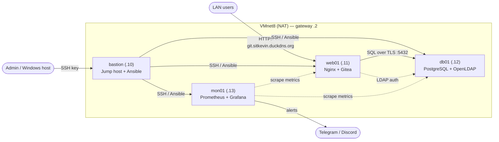
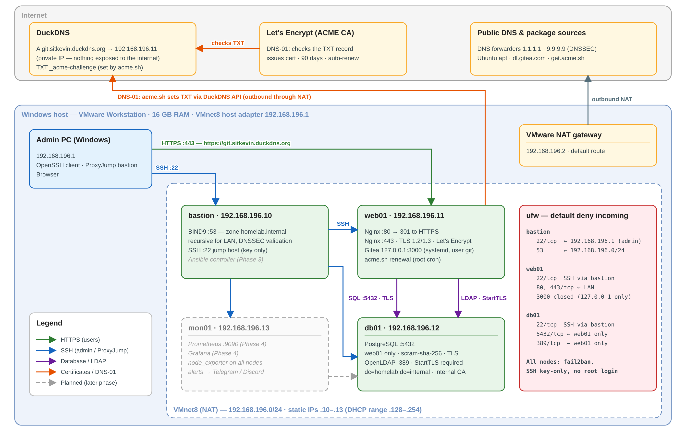

# Mini Company Infrastructure — Homelab

> A simulated IT infrastructure for a small company (~20 employees), built entirely with free and open-source software on VMware Workstation.


---

## 📌 Goals

This project demonstrates core system administration skills:

- **Build** — provision and configure Linux servers with a secure baseline
- **Automate** — rebuild the entire environment with a single Ansible command
- **Monitor** — collect metrics and send alerts when something breaks
- **Back up & restore** — schedule backups and *actually test* restoring them
- **Document** — write runbooks and postmortems like a real ops team

**Constraints:** 16 GB RAM host, zero cost, open-source only.

---

## 🗺️ Architecture



### Network diagram



---

## 🖥️ Virtual Machines

| VM      | Role                          | RAM    | IP               | OS                  |
|---------|-------------------------------|--------|------------------|---------------------|
| bastion | Jump host, Ansible controller | 1 GB   | 192.168.196.10   | Ubuntu 26.04.1 LTS  |
| web01   | Nginx reverse proxy + Gitea   | 1.5 GB | 192.168.196.11   | Ubuntu 26.04.1 LTS  |
| db01    | PostgreSQL (+ OpenLDAP)       | 1.5 GB | 192.168.196.12   | Ubuntu 26.04.1 LTS  |
| mon01   | Prometheus + Grafana          | 2 GB   | 192.168.196.13   | Ubuntu 26.04.1 LTS  |

**Host:** Windows, 16 GB RAM · **Hypervisor:** VMware Workstation · **Network:** VMnet8 (NAT) `192.168.196.0/24`, gateway/DNS `192.168.196.2`, VMware DHCP range `.128–.254` (static IPs are kept outside it)

**Template VM:** `ubuntu-template` — Ubuntu 26.04.1 LTS minimal + OpenSSH, fully updated, then cleaned before cloning (machine-id, SSH host keys, MAC binding). All nodes are **full clones**.

---

## 🌐 Services

| Service | URL / Endpoint | Host | Notes |
|---------|----------------|------|-------|
| Gitea   | `https://git.sitkevin.duckdns.org` | web01 | Nginx → `127.0.0.1:3000`, Let's Encrypt cert, auto-renew via acme.sh |
| PostgreSQL | `192.168.196.12:5432` | db01 | Only reachable from web01 (ufw + `pg_hba.conf`) |

> The DuckDNS name resolves to a **private** IP — nothing is exposed to the internet. The certificate is obtained with the DNS-01 challenge, which doesn't require inbound access.

---

## 🛣️ Roadmap

### Phase 1 — Foundation
- [x] Build a template VM and clone it
- [x] Configure static IPs and hostnames
- [x] Internal DNS resolution (BIND9 on bastion, `homelab.internal`, DNSSEC-validating forwarders)
- [x] SSH key authentication (bastion → all nodes, Windows → all nodes via ProxyJump)
- [x] Hardening: disable password login, UFW, fail2ban

### Phase 2 — Services
- [x] PostgreSQL on db01 (dedicated non-superuser role, web01-only access, TLS)
- [x] Gitea on web01 (systemd, unprivileged user, bound to localhost)
- [x] Nginx reverse proxy with Let's Encrypt SSL (DNS-01 via DuckDNS — works behind NAT)
- [ ] OpenLDAP for centralized user management
- [ ] End-to-end test: LDAP user → Gitea over HTTPS

📄 Build log, verification and debugging notes: [`docs/phase2-services.md`](docs/phase2-services.md)

### Phase 3 — Automation
- [ ] Ansible inventory and roles
- [ ] One-command playbook to rebuild the whole environment
- [ ] Bash maintenance scripts scheduled with cron

### Phase 4 — Monitoring & Backup
- [ ] Prometheus + node_exporter on all nodes
- [ ] Grafana dashboards
- [ ] Alerting to Telegram / Discord
- [ ] Backups with restic / borg
- [ ] **Tested restore** (documented end-to-end)

### Phase 5 — Documentation
- [ ] Finalize this README
- [x] Network diagram (draw.io)
- [ ] Runbooks
- [ ] Postmortems

### Optional extensions
- [ ] Docker
- [ ] Active Directory
- [ ] Loki (centralized logs)
- [ ] HAProxy + keepalived (high availability)

---

## 📁 Repository Structure (planned)

```
.
├── ansible/          # Inventory, playbooks, roles
├── scripts/          # Bash scripts (backup, health checks, ...)
├── configs/          # Reference config files
├── docs/
│   ├── phase2-services.md  # Phase 2 build log + debugging notes
│   ├── screenshots/  # Evidence per phase
│   ├── diagrams/     # draw.io network diagrams
│   ├── runbooks/     # Step-by-step operational procedures
│   └── postmortems/  # Incident write-ups
└── README.md
```

---

## 🚀 Quick Start

_Coming in Phase 3 — the goal is:_

```bash
ansible-playbook -i inventory site.yml
```

---

## 📄 License

MIT
