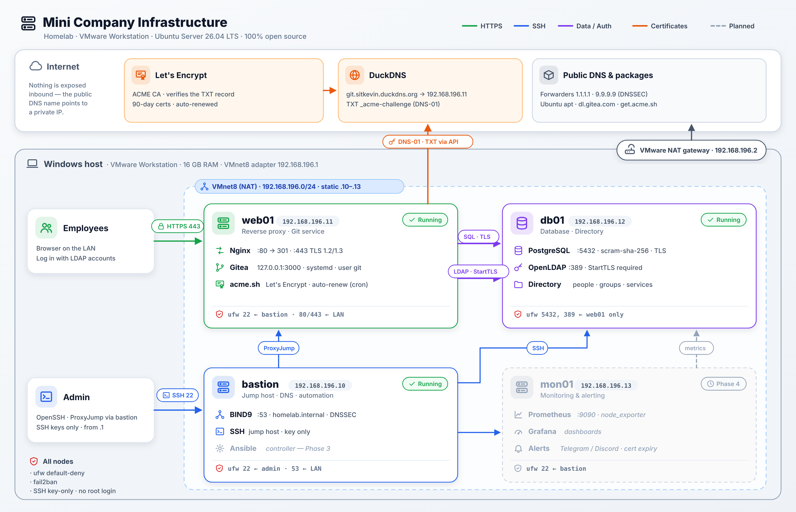

# Mini Company Infrastructure — Homelab

> A simulated IT infrastructure for a small company (~20 employees), built entirely with free and open-source software on VMware Workstation.


---

## 📌 Goals

This project demonstrates core system administration skills:

- **Build** — provision and configure Linux servers with a secure baseline
- **Automate** — converge the entire environment with a single Ansible command
- **Monitor** — collect metrics and send alerts when something breaks
- **Back up & restore** — schedule backups and *actually test* restoring them
- **Document** — write runbooks and postmortems like a real ops team

**Constraints:** 16 GB RAM host, zero cost, open-source only.

### ✨ Highlights

- **4 Ubuntu servers, 15 Ansible roles, one command:** `ansible-playbook site.yml` converges everything; a re-run reports `changed=0` on every host. Secrets in Ansible Vault.
- **Security by default:** ufw default-deny everywhere, SSH keys only through a bastion, services bound to `127.0.0.1` behind Nginx or SSH tunnels, database and LDAP reachable from web01 only, TLS everywhere (Let's Encrypt via DNS-01 behind NAT, internal CA for LDAP).
- **Central identity:** Gitea logs in against OpenLDAP; only the `staff` group gets in — removing someone from a group removes their access.
- **Monitoring that pages:** Prometheus, Grafana and 9 alert rules delivered to Discord (host down, disk, memory, failed units, PostgreSQL, HTTPS endpoint, certificate expiry, backup failed / too old).
- **Backups that are proven:** nightly encrypted restic snapshots of Gitea, PostgreSQL and LDAP, monitored by Prometheus; restore verified against the live data.
- **Run like an ops team:** dry runs (`--check --diff`) and canaries before changes, runbooks, and blameless postmortems of real incidents.

### 🧰 Tech stack

| Area | Tools |
|---|---|
| Virtualisation / OS | VMware Workstation, Ubuntu Server 26.04 LTS |
| Network & access | BIND9 (DNSSEC), OpenSSH (ProxyJump), ufw, fail2ban |
| Services | Nginx, Gitea, PostgreSQL, OpenLDAP |
| TLS | Let's Encrypt (acme.sh, DNS-01 via DuckDNS), internal CA (OpenSSL) |
| Automation | Ansible (roles, Vault), Bash, cron, systemd timers |
| Monitoring | Prometheus, node / postgres / blackbox exporters, Alertmanager → Discord, Grafana |
| Backup | restic over SFTP |

---

## 🗺️ Architecture



---

## 🖥️ Virtual Machines

| VM      | Role                          | RAM    | IP               | OS                  |
|---------|-------------------------------|--------|------------------|---------------------|
| bastion | Jump host, Ansible controller | 1 GB   | 192.168.196.10   | Ubuntu 26.04.1 LTS  |
| web01   | Nginx reverse proxy + Gitea   | 1.5 GB | 192.168.196.11   | Ubuntu 26.04.1 LTS  |
| db01    | PostgreSQL (+ OpenLDAP)       | 1.5 GB | 192.168.196.12   | Ubuntu 26.04.1 LTS  |
| mon01   | Prometheus + Grafana          | 2 GB   | 192.168.196.13   | Ubuntu 26.04.1 LTS  |

**Host:** Windows, 16 GB RAM · **Hypervisor:** VMware Workstation · **Network:** VMnet8 (NAT) `192.168.196.0/24`, gateway/DNS `192.168.196.2`, VMware DHCP range `.128–.254` (static IPs are kept outside it)

**Template VM:** `ubuntu-template` — Ubuntu 26.04.1 LTS minimal + OpenSSH, fully updated, then cleaned before cloning (machine-id, SSH host keys, MAC binding). All nodes are **full clones**.

---

## 🌐 Services

| Service | URL / Endpoint | Host | Notes |
|---------|----------------|------|-------|
| Gitea   | `https://git.sitkevin.duckdns.org` | web01 | Nginx → `127.0.0.1:3000`, Let's Encrypt cert, auto-renew via acme.sh |
| PostgreSQL | `192.168.196.12:5432` | db01 | Only reachable from web01 (ufw + `pg_hba.conf`) |
| OpenLDAP | `ldap://db01.homelab.internal:389` (StartTLS) | db01 | Only from web01; internal CA `configs/ldap/homelab-ca.crt` |
| Grafana | `http://localhost:3000` via `ssh -L 3000:127.0.0.1:3000 mon01` | mon01 | Prometheus, Alertmanager and Grafana listen on `127.0.0.1` only |
| Alerts | Discord channel | mon01 → Discord | Alertmanager webhook, FIRING + RESOLVED |
| Backups | `sftp://mon01/srv/restic/<host>` | web01, db01 → mon01 | restic, nightly systemd timer, one SFTP-only user per host |

> The DuckDNS name resolves to a **private** IP — nothing is exposed to the internet. The certificate is obtained with the DNS-01 challenge, which doesn't require inbound access.

---

## 🛣️ Roadmap

### Phase 1 — Foundation ✅
- [x] Build a template VM and clone it
- [x] Configure static IPs and hostnames
- [x] Internal DNS resolution (BIND9 on bastion, `homelab.internal`, DNSSEC-validating forwarders)
- [x] SSH key authentication (bastion → all nodes, Windows → all nodes via ProxyJump)
- [x] Hardening: disable password login, UFW, fail2ban

📄 Template, DNS/DNSSEC debugging, SSH and firewall: [`docs/phase1-foundation.md`](docs/phase1-foundation.md)

### Phase 2 — Services ✅
- [x] PostgreSQL on db01 (dedicated non-superuser role, web01-only access, TLS)
- [x] Gitea on web01 (systemd, unprivileged user, bound to localhost)
- [x] Nginx reverse proxy with Let's Encrypt SSL (DNS-01 via DuckDNS — works behind NAT)
- [x] OpenLDAP on db01 (`dc=homelab,dc=internal`, read-only bind account, no anonymous read, StartTLS mandatory with an internal CA)
- [x] Gitea login via LDAP (only group `staff`, admins via filter) — end-to-end tested

📄 Build log, verification and debugging notes: [`docs/phase2-services.md`](docs/phase2-services.md)

### Phase 3 — Automation ✅
- [x] Ansible inventory and 7 roles (common, bind9, postgresql, openldap, gitea, nginx, maintenance), secrets in Ansible Vault
- [x] One command — `ansible-playbook site.yml` — converges all 4 servers, idempotent (`changed=0` on re-run)
- [x] Bash health checks (`node-check.sh`, `lab-check.sh`) scheduled with cron, logged to file + syslog

📄 Roles, safe change workflow, secrets, drift found, health checks: [`docs/phase3-automation.md`](docs/phase3-automation.md)

### Phase 4 — Monitoring & Backup ✅
- [x] Prometheus + node_exporter on all nodes, PostgreSQL exporter, blackbox HTTPS/certificate probe
- [x] Grafana dashboards (provisioned as code), reached through an SSH tunnel
- [x] 9 alert rules → Alertmanager → Discord (tested: FIRING and RESOLVED)
- [x] Nightly encrypted backups with restic (Gitea data, PostgreSQL dump, LDAP export) to mon01 over SFTP, monitored by Prometheus
- [x] Restore verified: PostgreSQL restored into a scratch database and LDAP export compared with the live directory — identical ([runbook](docs/runbooks/restore.md))

📄 Monitoring architecture, alert rules, backup design, restore results: [`docs/phase4-monitoring-backup.md`](docs/phase4-monitoring-backup.md)

---

## 📁 Repository Structure

```
.
├── ansible/          # site.yml, playbooks, 15 roles, inventory, Vault
├── scripts/          # node-check.sh, lab-check.sh, restic-backup.sh
├── configs/          # Reference config files used by the roles
├── docs/
│   ├── phase1-foundation.md        # VMs, DNS/DNSSEC, SSH, firewall
│   ├── phase2-services.md          # PostgreSQL, Gitea, Nginx + SSL, OpenLDAP
│   ├── phase3-automation.md        # Ansible roles, Vault, health checks
│   ├── phase4-monitoring-backup.md # Prometheus, Grafana, alerts, restic
│   ├── runbooks/                   # alerts, restore, user management
│   ├── postmortems/                # incident write-ups
│   ├── diagrams/                   # architecture diagram
│   └── screenshots/                # evidence per phase
└── README.md
```

---

## 🚀 Quick Start

From the bastion (Ansible control node):

```bash
cd ~/homelab-mini-company/ansible
ansible-playbook site.yml --check --diff   # dry run: what would change on every server
ansible-playbook site.yml                  # converge the whole homelab
```

Secrets come from Ansible Vault (`~/.ansible/vault_pass` on the bastion). Details: [`ansible/README.md`](ansible/README.md).
