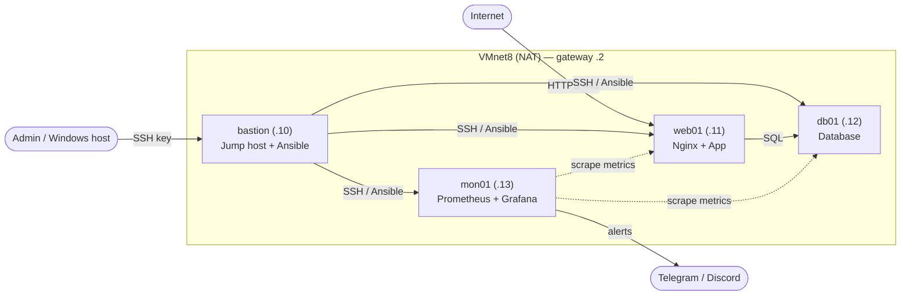

# Mini Company Infrastructure — Homelab

> A simulated IT infrastructure for a small company (~20 employees), built entirely with free and open-source software on VMware Workstation.


---

## 📌 Goals

This project demonstrates core system administration skills:

- **Build** — provision and configure Linux servers with a secure baseline
- **Automate** — rebuild the entire environment with a single Ansible command
- **Monitor** — collect metrics and send alerts when something breaks
- **Back up & restore** — schedule backups and *actually test* restoring them
- **Document** — write runbooks and postmortems like a real ops team

**Constraints:** 16 GB RAM host, zero cost, open-source only.

---

## 🗺️ Architecture (planned)



> A detailed network diagram (draw.io) will be added in `docs/diagrams/`.

---

## 🖥️ Virtual Machines

| VM      | Role                          | RAM    | IP   | OS                   |
|---------|-------------------------------|--------|------|----------------------|
| bastion | Jump host, Ansible controller | 1 GB   | .10  | Ubuntu Server LTS    |
| web01   | Nginx reverse proxy + app     | 1.5 GB | .11  | Ubuntu Server LTS    |
| db01    | Database                      | 1.5 GB | .12  | Ubuntu Server LTS    |
| mon01   | Prometheus + Grafana          | 2 GB   | .13  | Ubuntu Server LTS    |

**Host:** Windows, 16 GB RAM · **Hypervisor:** VMware Workstation · **Network:** VMnet8 (NAT), static IPs, gateway `.2`

---

## 🛣️ Roadmap

### Phase 1 — Foundation
- [ ] Build a template VM and clone it
- [ ] Configure static IPs and hostnames
- [ ] Internal DNS resolution
- [ ] SSH key authentication (bastion → all nodes)
- [ ] Hardening: disable password login, UFW, fail2ban

### Phase 2 — Services
- [ ] Nginx reverse proxy with SSL
- [ ] Deploy an application (WordPress / Nextcloud / Gitea)
- [ ] Database on db01
- [ ] LDAP for centralized user management

### Phase 3 — Automation
- [ ] Ansible inventory and roles
- [ ] One-command playbook to rebuild the whole environment
- [ ] Bash maintenance scripts scheduled with cron

### Phase 4 — Monitoring & Backup
- [ ] Prometheus + node_exporter on all nodes
- [ ] Grafana dashboards
- [ ] Alerting to Telegram / Discord
- [ ] Backups with restic / borg
- [ ] **Tested restore** (documented end-to-end)

### Phase 5 — Documentation
- [ ] Finalize this README
- [ ] Network diagram (draw.io)
- [ ] Runbooks
- [ ] Postmortems

### Optional extensions
- [ ] Docker
- [ ] Active Directory
- [ ] Loki (centralized logs)
- [ ] HAProxy + keepalived (high availability)

---

## 📁 Repository Structure (planned)

```
.
├── ansible/          # Inventory, playbooks, roles
├── scripts/          # Bash scripts (backup, health checks, ...)
├── configs/          # Reference config files
├── docs/
│   ├── diagrams/     # draw.io network diagrams
│   ├── runbooks/     # Step-by-step operational procedures
│   └── postmortems/  # Incident write-ups
└── README.md
```

---

## 🚀 Quick Start

_Coming in Phase 3 — the goal is:_

```bash
ansible-playbook -i inventory site.yml
```

---

## 🧠 Lessons Learned

<!-- Update after each phase: problem → how I debugged it → root cause → fix -->

_To be filled in as the project progresses._

---

## 📄 License

MIT