# Phase 1 — Foundation

> Status: ✅ **complete** — 4 Ubuntu Server VMs cloned from one template, static IPs, internal DNS with DNSSEC validation, SSH key-only access through a bastion, ufw and fail2ban on every host. Since Phase 3 all of this is enforced by the Ansible roles `common` and `bind9`.

Config: [`configs/netplan/`](../configs/netplan/), [`configs/bind/`](../configs/bind/), [`configs/ssh/`](../configs/ssh/), [`configs/windows/ssh_config`](../configs/windows/ssh_config), [`configs/fail2ban/`](../configs/fail2ban/)

## 1. Template VM and clones

- `ubuntu-template`: Ubuntu Server 26.04.1 LTS minimal + OpenSSH, fully updated.
- Before cloning, everything that must be **unique per machine** is removed: `/etc/machine-id`, SSH host keys, the MAC binding of the network interface. Otherwise every clone would share the same identity (same DHCP lease, same host keys → SSH can't tell the servers apart).
- All nodes are **full clones** (independent disks).

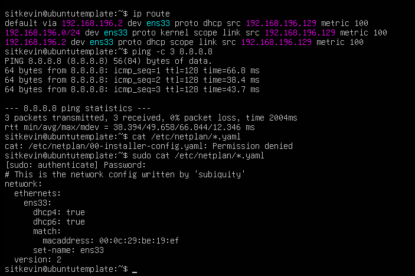
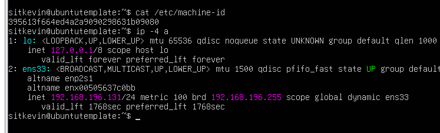

## 2. Static IPs

VMware NAT network `192.168.196.0/24`, gateway `.2`. The VMware DHCP range is `.128–.254`, so the static addresses `.10–.13` can never collide with a lease. DNS points to the bastion, search domain `homelab.internal` → [`00-installer-config.yaml`](../configs/netplan/00-installer-config.yaml).

| Host | IP |
|---|---|
| bastion | 192.168.196.10 |
| web01 | 192.168.196.11 |
| db01 | 192.168.196.12 |
| mon01 | 192.168.196.13 |

## 3. Internal DNS — BIND9 on the bastion

- Zones `homelab.internal` (name → IP) and `196.168.192.in-addr.arpa` (IP → name), checked with `named-checkzone` → [`zones/`](../configs/bind/zones/)
- Recursive resolver **for the LAN only** (`allow-query`/`allow-recursion` = trusted ACL) — not an open resolver that could be abused for DNS amplification; no zone transfers.

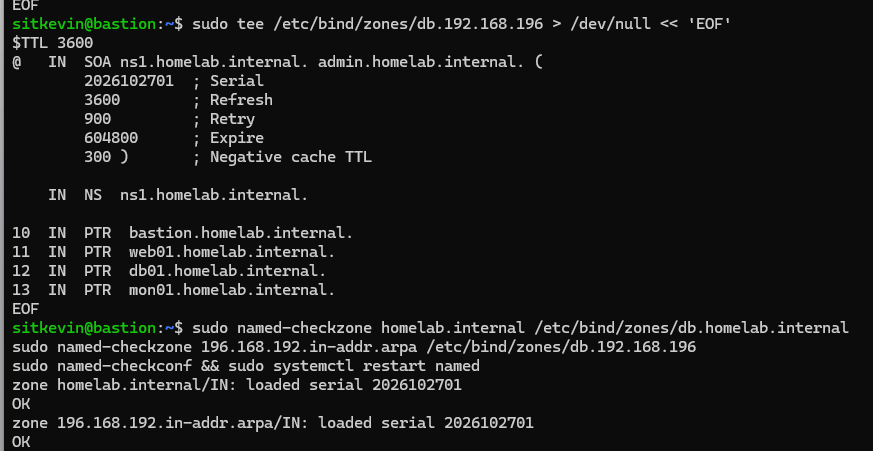
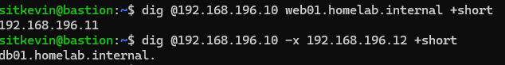

### Debugging: SERVFAIL for every external name

With the VMware NAT DNS (`192.168.196.2`) as forwarder, every external lookup returned `SERVFAIL`. Root cause: BIND validates DNSSEC (`dnssec-validation auto`), but the VMware NAT DNS does not pass DNSSEC records, so validation could never succeed. Fix: forward to DNSSEC-capable public resolvers (`1.1.1.1`, `9.9.9.9`, `forward only`) → [`named.conf.options`](../configs/bind/named.conf.options).

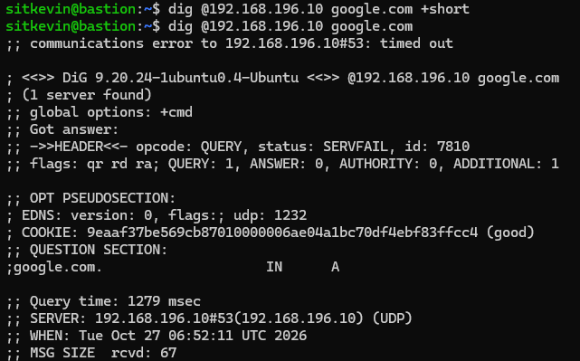

Verification: `google.com` resolves, `cloudflare.com` comes back with the **`ad`** flag (authenticated data = validated), and the deliberately broken `dnssec-failed.org` returns `SERVFAIL` — proof that validation really happens.

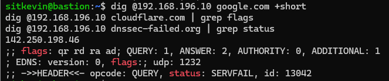

## 4. SSH: keys only, through the bastion

- Key authentication from the admin PC to the bastion and from the bastion to every node. The Windows `ssh_config` reaches web01/db01/mon01 with **`ProxyJump bastion`** → [`ssh_config`](../configs/windows/ssh_config).
- Hardening drop-in [`00-hardening.conf`](../configs/ssh/00-hardening.conf): no passwords, no keyboard-interactive, no root login. It is named **`00-`** on purpose: sshd keeps the **first** value it reads, and Ubuntu's `50-cloud-init.conf` sets `PasswordAuthentication yes`.
- Verified with `sshd -T`, not by reading the file.

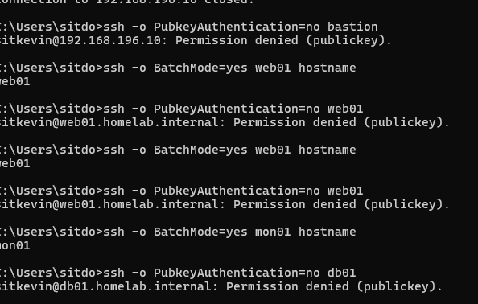

## 5. Firewall and brute-force protection

- **ufw, default deny incoming**: the bastion accepts SSH only from the admin PC (`192.168.196.1`) and DNS from the LAN; the other nodes accept SSH **only from the bastion**.
- **fail2ban** (`sshd` jail, systemd backend) bans through ufw; the admin PC and the bastion are in `ignoreip` so automation can never lock itself out → [`jail.local`](../configs/fail2ban/jail.local).

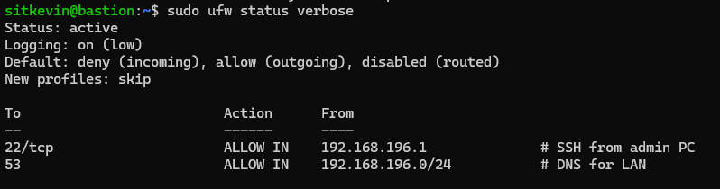
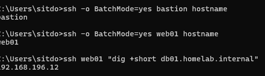
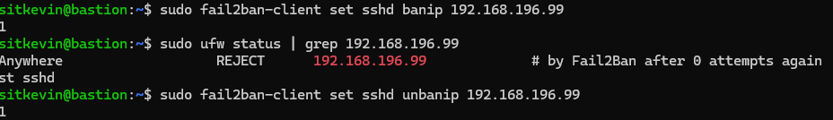

## Final check (all 4 hosts)

fail2ban active, ufw active, `passwordauthentication no`:

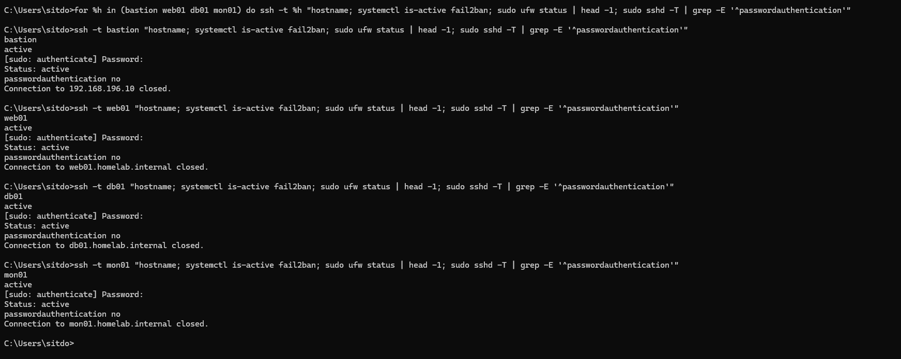
