# Phase 2 — Services (build log)

> Status: steps 1–4 done (PostgreSQL, Gitea, Nginx, SSL). Step 5 (OpenLDAP) in progress.

## Target architecture

```
User ──HTTPS 443──> web01 (.11)  Nginx ──> Gitea 127.0.0.1:3000
                                              │
                                              ├──SQL/TLS──> db01 (.12) PostgreSQL :5432 (web01 only)
                                              └──LDAP────> db01 (.12) OpenLDAP (planned)
```

| Component  | Host  | Listens on              | Reachable from          |
|------------|-------|-------------------------|-------------------------|
| PostgreSQL | db01  | 127.0.0.1, .12 : 5432   | web01 only (ufw + pg_hba) |
| Gitea      | web01 | 127.0.0.1 : 3000        | localhost only (Nginx)  |
| Nginx      | web01 | 0.0.0.0 : 80, 443       | everyone in the LAN     |

**Why Gitea?** Lightweight (~200–300 MB RAM, fits a 1.5 GB VM; GitLab needs ~4 GB), single Go binary, built-in LDAP support, and it will host this project's own Ansible code in Phase 3.

**Public URL:** `https://git.sitkevin.duckdns.org` — a DuckDNS record that points to the **private** IP `192.168.196.11`. Nothing is exposed to the internet; the name just resolves the same way for every machine in the lab (DuckDNS also answers wildcards, so `*.sitkevin.duckdns.org` can be used for future services).

---

## Step 1 — PostgreSQL on db01

Config: [`configs/postgresql/`](../configs/postgresql/)

1. `sudo apt install -y postgresql`
2. Create an **empty database + dedicated non-superuser role** → [`create-gitea-db.sql`](../configs/postgresql/create-gitea-db.sql). Gitea creates its own tables on first run.
   *Why:* least privilege — the app never gets the `postgres` superuser.
3. `listen_addresses = 'localhost,192.168.196.12'` → [`postgresql.conf.snippet`](../configs/postgresql/postgresql.conf.snippet)
4. `pg_hba.conf`: only `gitea` → `gitea` from `192.168.196.11/32` with `scram-sha-256` → [`pg_hba.conf.snippet`](../configs/postgresql/pg_hba.conf.snippet)
5. ufw: allow 5432 from web01 only → [`configs/ufw/phase2-rules.sh`](../configs/ufw/phase2-rules.sh)
   *Why two layers (ufw + pg_hba):* defense in depth — a mistake in one layer is still caught by the other.

**Verification**

| Test | Expected | Result |
|------|----------|--------|
| `psql -h 192.168.196.12 -U gitea -d gitea -c '\conninfo'` from **web01** | connects | ✅ TLS 1.3, `Superuser off` |
| `nc -zv -w 3 192.168.196.12 5432` from **bastion** | blocked | ✅ timeout (ufw DROP) |

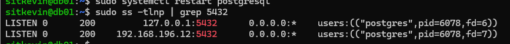
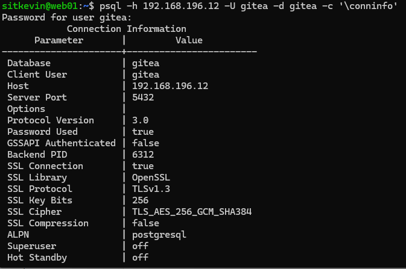
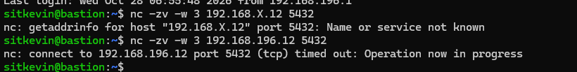

> **Reading the error tells you which layer blocked you:** `timed out` = dropped by ufw · `no pg_hba.conf entry for host ...` = rejected by PostgreSQL · `connection refused` = nothing listening on that IP/port.

---

## Step 2 — Gitea on web01

Config: [`configs/gitea/`](../configs/gitea/)

1. `apt install git`; system user `git` (`--system --disabled-password`, shell bash for SSH clones).
   *Why:* if Gitea is compromised, the attacker only gets an unprivileged user.
2. Download the binary from `dl.gitea.com` (latest version from `version.json`), **verify `sha256sum -c`**, install to `/usr/local/bin/gitea` (manually installed software lives in `/usr/local`, apt owns `/usr/bin`).
3. Directories: `/var/lib/gitea/{custom,data,log}` → `git:git 750`; `/etc/gitea` → `root:git 770` **only during the web installer**.
4. systemd unit → [`gitea.service`](../configs/gitea/gitea.service) (`Restart=always`, logs in `journalctl -u gitea`).
5. Web installer reached through an **SSH tunnel** instead of opening port 3000:
   ```powershell
   ssh -J sitkevin@192.168.196.10 -L 3000:127.0.0.1:3000 sitkevin@192.168.196.11
   # then browse http://localhost:3000
   ```
   *Why:* whoever reaches the installer first becomes admin — the tunnel limits that to SSH-key holders.
   Settings: PostgreSQL with `SSL=require`, self-registration disabled, sign-in required, admin account created during install.
6. Lock down after install: `/etc/gitea` → `750`, `app.ini` → `640` (it contains the DB password and secret keys). `HTTP_ADDR = 127.0.0.1` → [`app.ini.example`](../configs/gitea/app.ini.example)

**Backup note for Phase 4:** repositories live on **web01 disk** (`/var/lib/gitea/data`), metadata lives in **PostgreSQL on db01** — a backup needs both.

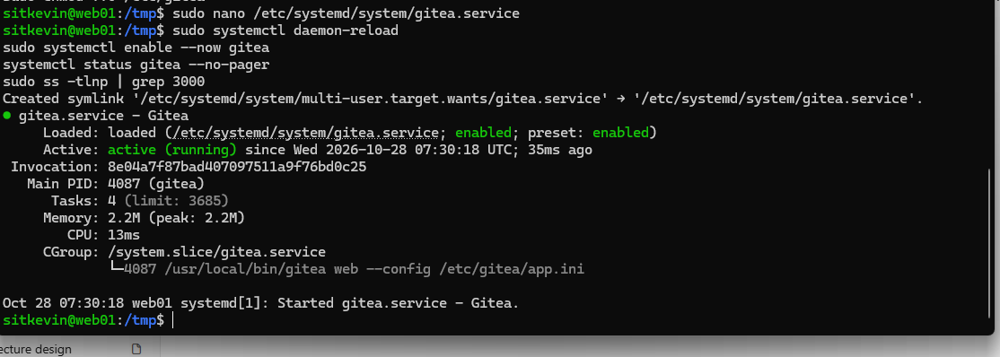
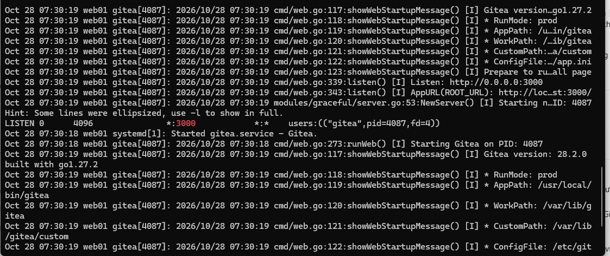
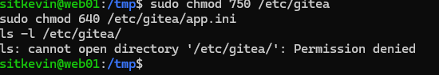
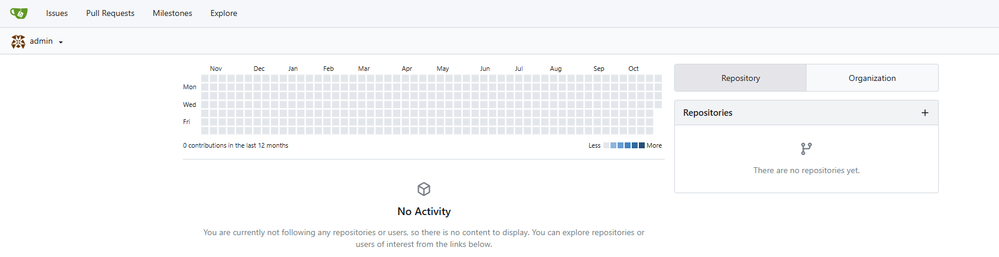

---

## Step 3 — Nginx reverse proxy

Config: [`configs/nginx/gitea.conf`](../configs/nginx/gitea.conf)

- `proxy_pass http://127.0.0.1:3000` + `X-Real-IP` / `X-Forwarded-*` headers so Gitea (and fail2ban) see the real client IP.
- `client_max_body_size 512M` (default 1 MB breaks large pushes with HTTP 413).
- ufw: `allow 'Nginx Full'` (80 + 443). Port 3000 stays closed.
- Gitea `ROOT_URL` / `DOMAIN` updated so clone URLs are correct.
- Habit: **always `nginx -t` before `systemctl reload nginx`.**

**Verification (from bastion, not from web01 itself)**

| Test | Expected | Result |
|------|----------|--------|
| `curl -I http://git.sitkevin.duckdns.org` | 200 | ✅ |
| `nc -zv -w 3 192.168.196.11 3000` | blocked | ✅ timeout |

Gitea is now protected by two layers: ufw drops port 3000, and Gitea only binds to 127.0.0.1 anyway.

---

## Step 4 — Let's Encrypt SSL via DNS-01

**Why DNS-01 instead of HTTP-01:** HTTP-01 requires Let's Encrypt to reach `http://<domain>/.well-known/...` from the internet; our VMs sit behind VMware NAT. DNS-01 only requires publishing a TXT record — `acme.sh` does that through the DuckDNS API — so a private server gets a real, publicly trusted certificate.

```bash
sudo -i
curl https://get.acme.sh | sh                         # installs to /root/.acme.sh + renewal cron
/root/.acme.sh/acme.sh --set-default-ca --server letsencrypt   # default CA is ZeroSSL

read -s -p "DuckDNS token: " DuckDNS_Token; echo      # keeps the token out of bash history
export DuckDNS_Token
/root/.acme.sh/acme.sh --issue --dns dns_duckdns -d git.sitkevin.duckdns.org --dnssleep 60

mkdir -p /etc/nginx/ssl
/root/.acme.sh/acme.sh --install-cert -d git.sitkevin.duckdns.org \
  --key-file       /etc/nginx/ssl/git.key \
  --fullchain-file /etc/nginx/ssl/git.fullchain.pem \
  --reloadcmd      "systemctl reload nginx"
chmod 600 /etc/nginx/ssl/git.key
```

- The token is stored by acme.sh in `/root/.acme.sh/account.conf` (root only) for renewals.
- `--install-cert` copies the cert to a stable path and re-runs `--reloadcmd` after every renewal.
- Certificates are valid 90 days; acme.sh renews automatically (~30 days before expiry). Let's Encrypt no longer sends expiry emails → expiry alerting will be done by Prometheus in Phase 4.
- Nginx: HTTP → HTTPS `301`, TLS 1.2/1.3 only, `fullchain` (includes intermediate), `server_tokens off` → [`nginx.conf.snippet`](../configs/nginx/nginx.conf.snippet).

**Verification**

| Test | Expected | Result |
|------|----------|--------|
| `curl -I http://git.sitkevin.duckdns.org` | 301 → https | ✅ |
| `curl -I https://git.sitkevin.duckdns.org` | 200, no cert error | ✅ |
| `openssl s_client ... \| openssl x509 -noout -issuer -dates` | Let's Encrypt, 90 days | ✅ YE1, 2026-10-28 → 2027-01-26 |
| Browser | padlock, no warning | ✅ |

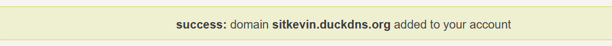
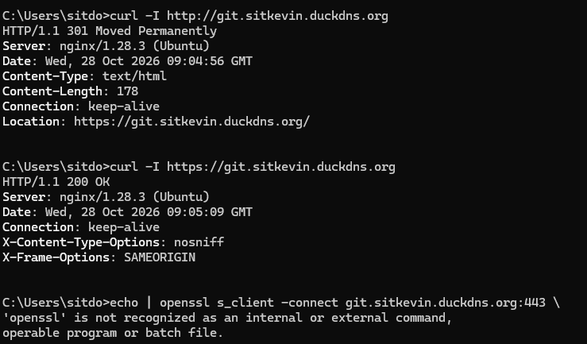
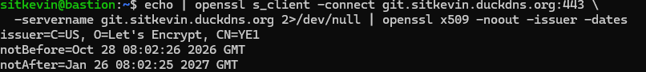
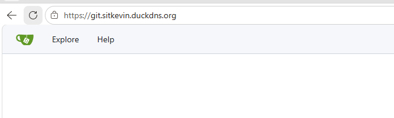

---

## Step 5 — OpenLDAP (TODO)

- [ ] `slapd` on db01, base DN `dc=homelab,dc=internal` (matches the internal DNS zone), `ou=people`, `ou=groups`
- [ ] Groups `it`, `dev`, `staff` + sample users
- [ ] Read-only bind DN for Gitea, ufw: LDAP only from web01, StartTLS/LDAPS
- [ ] Gitea authentication source: LDAP (via BindDN)

## Step 6 — End-to-end test (TODO)

- [ ] LDAP user logs in to Gitea over HTTPS, creates a repo, clones it

---

## Issues & debugging log

| # | Symptom | Root cause | Fix | Lesson |
|---|---------|------------|-----|--------|
| 1 | `nano /etc/postgresql/16/main/postgresql.conf` opened an **empty** file | Guessed the PostgreSQL version in the path; the installed version is different. nano silently creates a new file | Exit without saving; `sudo -u postgres psql -c 'SHOW config_file;'` | Ask the service for its config path instead of guessing |
| 2 | `ss -tlnp` showed only `127.0.0.1:5432` after editing | `listen_addresses` change not effective (not applied/saved correctly) | Fixed the line, restarted, verified with `SHOW listen_addresses;` | Verify the *running* value, not just the file ([before](screenshots/stage2/01-postgres-listen-localhost-only.png)) |
| 3 | `psql` looked "stuck" / screen full of `~` and `(END)` | Multi-line SQL waits for `;`; `\l` output opened the `less` pager | `;` to finish, `q` to leave the pager, `\pset pager off` | Read the prompt: `=#` ready, `-#` continuation, `'#` open quote |
| 4 | Gitea install commands ran on **db01** | Wrong terminal tab | Full cleanup, redone on web01 | See [postmortem](postmortems/2026-10-28-gitea-installed-on-wrong-host.md) |
| 5 | `systemctl status` OK but `ss` showed nothing on :3000 | Status was taken 35 ms after start; service had not bound yet | Re-check after a few seconds + `journalctl -u gitea` | `status` is a snapshot, the journal is the history |
| 6 | Installer: *"You cannot disable user self-registration without creating an administrator account"* | Registration disabled but no admin defined → nobody could ever log in | Filled in the admin account section | "Optional" admin is only optional when self-registration is open |
| 7 | `ls /etc/gitea` → Permission denied | Expected: dir is `root:git 750`, my user is not in group `git` | `sudo ls -l /etc/gitea` | Proof the lockdown works |
| 8 | `nc` to web01:3000 returned **refused**, not timeout | Test was run **on web01 itself** → loopback traffic bypasses ufw | Re-ran from bastion → timeout | Always test from the client's point of view |
| 9 | `acme.sh: command not found` right after "Install success" | Installer adds an alias to `~/.bashrc`, current shell had not re-read it | Call `/root/.acme.sh/acme.sh` directly (or `source ~/.bashrc`) | Don't `apt install acme.sh` on top — two copies cause confusion |
| 10 | `openssl` not found / `\` broke the command on Windows | cmd has no openssl and no `\` line continuation | Ran it on bastion | Know which shell you're in |
