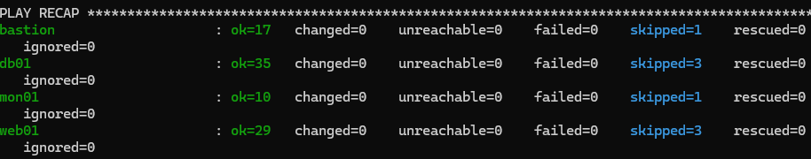
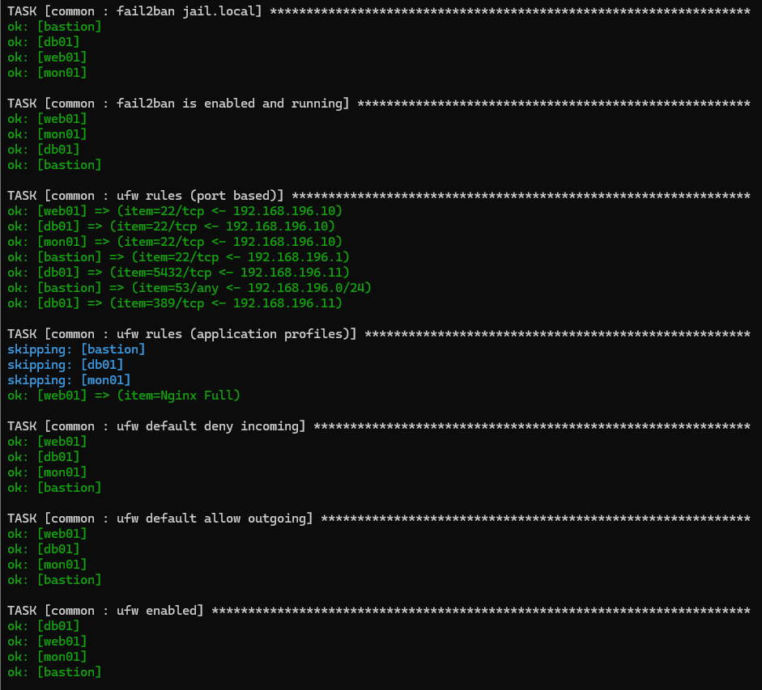
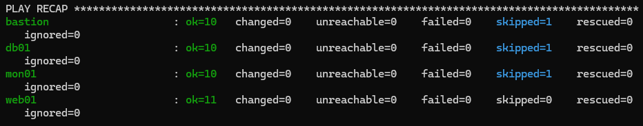
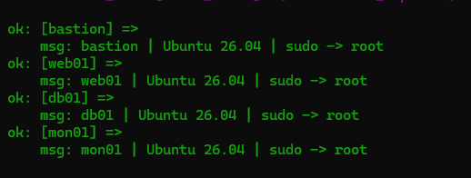
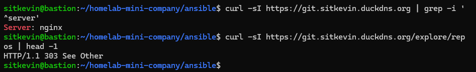
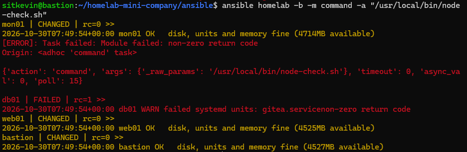
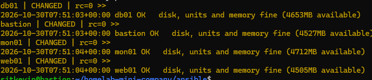
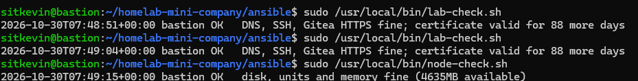

# Phase 3 — Automation (Ansible + Bash)

> Status: ✅ **complete** — every service from Phase 1–2 is described as code in 7 Ansible roles; `ansible-playbook site.yml` converges all 4 servers with `changed=0`. Health-check scripts run from cron on every host.



## Overview

- **Control node:** the bastion. Ansible is agentless — it only needs SSH + Python on the managed hosts.
- **Code:** [`ansible/`](../ansible/) (roles, playbooks, inventory) and [`scripts/`](../scripts/) (Bash).
- **Single source of truth:** roles copy the same files documented in Phase 1–2 from [`configs/`](../configs/) instead of duplicating them.

```bash
cd ~/homelab-mini-company/ansible
ansible-playbook site.yml --check --diff   # what WOULD change, on every host
ansible-playbook site.yml                  # converge the whole homelab
```

| Role | Hosts | Manages | Secrets (Vault) |
|---|---|---|---|
| `common` | all | SSH hardening, ufw (rules per host in `host_vars`), fail2ban, internal CA | — |
| `bind9` | bastion | BIND9 options, zones (validated with `named-checkconf` / `named-checkzone`) | — |
| `postgresql` | db01 | `listen_addresses`, `ssl` (ALTER SYSTEM), `pg_hba` line, gitea role + DB | DB password |
| `openldap` | db01 | slapd, TLS files, `cn=config` (TLS, `ssf=1`, ACL), OUs, users, groups, service account | admin / bind / initial passwords, TLS private key |
| `gitea` | web01 | checksum-verified binary (pinned version), user, dirs, `app.ini` key by key, systemd unit | DB password, internal token, JWT secrets |
| `nginx` | web01 | `server_tokens off`, site config, Let's Encrypt cert on a fresh host | DuckDNS token |
| `maintenance` | all | `node-check.sh` (all), `lab-check.sh` (bastion), cron, logrotate | — |

`site.yml` order: **common → dns → db → ldap → web → maintenance** (baseline first, DNS before everything that resolves names, data services before the web tier that uses them).

---

## Safe change workflow

Every role was introduced on servers that were **already running**, so the goal of the first run was "describe reality", not "change things":

1. **Read the live state first** (ad-hoc, read-only): `ansible homelab -b -m command -a "ufw status numbered"`, `pg_lsclusters`, `grep` on configs…
2. **Dry run:** `--check --diff` — every `changed` is read line by line before applying.
3. **Canary:** `--limit mon01` (least important host) before all hosts.
4. **Apply**, then **run again**: the second run must report `changed=0` (idempotency).
5. Verify the service from the client side (`dig`, `curl`, Gitea login).




### Safety nets built into the roles

| Risk | Protection |
|---|---|
| Broken sshd config locks everyone out | `sshd -t` before reloading ssh; ufw rules are added **before** ufw is enabled; no `ufw reset` |
| Broken DNS takes the whole lab down | each file validated before it is written, `named-checkconf -z` before reload |
| Broken Nginx config | `nginx -t` before reload |
| Restart where a reload is enough | PostgreSQL: `restart` only for `listen_addresses`/`ssl`, `reload` for `pg_hba.conf` |
| Passwords in logs | `no_log: true` on every task that handles a secret |
| Resetting users' own passwords | LDAP initial password only for users **created in that run** |
| Rotating Gitea secrets by accident | existing `INTERNAL_TOKEN` / JWT secrets moved into Vault, `ini_file` only edits the managed keys |

---

## Secrets — Ansible Vault

- Vault password: `~/.ansible/vault_pass` on the bastion (`chmod 600`, outside the repo, backed up in a password manager).
- Secrets: [`ansible/inventory/group_vars/all/vault.yml`](../ansible/inventory/group_vars/all/vault.yml), AES-256, committed.
- Convention: secrets are named `vault_*`; `vars.yml` only references them (`ansible_become_password: "{{ vault_become_password }}"`) → no more `-K`.
- Whole files can be encrypted too: the LDAP private key is stored as [`configs/ldap/ldap.key.vault`](../configs/ldap/ldap.key.vault); `copy` decrypts it on the way to db01. The **CA private key is not in Ansible** — it stays on db01 only.
- The bastion pushes to GitHub with a **deploy key** (write access to this repo only, not the whole account).
- Before every commit: `head -1 vault.yml` must show `$ANSIBLE_VAULT;1.1;AES256`.



> Lab note: the LDAP accounts use simple passwords to keep the lab easy to operate. In production they would be generated randomly and live only in Vault.

---

## Configuration drift found while writing the roles

Writing the roles against the live servers revealed differences between **what the docs said** and **what was actually configured**:

| Where | Docs said | Server had | Now |
|---|---|---|---|
| Nginx `server_tokens` | `off` | `build` (version + build number exposed) | `off` |
| Gitea `REQUIRE_SIGNIN_VIEW` | `true` | `false` (Explore visible to anonymous users) | `true` → `/explore` redirects to login (303) |
| OpenLDAP `olcSecurity` | `tls=1` | `tls=1` — but this locked root out of `cn=config` | `ssf=1` ([postmortem](postmortems/2026-10-30-ldap-cn-config-lockout.md)) |
| `/etc/bind/zones` | — | mode `2755` (setgid, Ubuntu default) | role sets `0755`; no functional impact (files get group `bind` explicitly) |
| Several config files | comments | no comments | repo version (comments only, verified in `--diff`) |



---

## Health checks (Bash + cron)

| Script | Runs on | Checks | Exit codes |
|---|---|---|---|
| [`node-check.sh`](../scripts/node-check.sh) | every host | disk ≥ 80 %, failed systemd units, available memory < 100 MB | 0 OK · 1 warning |
| [`lab-check.sh`](../scripts/lab-check.sh) | bastion | internal DNS for every node, SSH port of every node, Gitea over HTTPS, certificate expiry < 14 days | 0 OK · 1 warning · 2 missing tool |

- `set -euo pipefail`, clean `shellcheck`, every warning goes to `/var/log/homelab/*.log` **and** syslog (`logger`), logs rotated weekly (4 weeks).
- `lab-check.conf` is generated from the inventory — a new host in `hosts.ini` is checked automatically.
- Tested before deployment for every path: healthy, full disk, failed unit, **systemctl unavailable** (first version skipped it silently — fixed), unreachable lab, **missing `dig`** (first version reported it as "DNS no answer" — fixed), expiring certificate.

**First run found a real problem:** `db01 WARN failed systemd units: gitea.service` — a leftover of the [2026-10-28 incident](postmortems/2026-10-28-gitea-installed-on-wrong-host.md). The unit file had been removed, but systemd still remembered the failed state. Fixed with `systemctl reset-failed gitea.service`.




