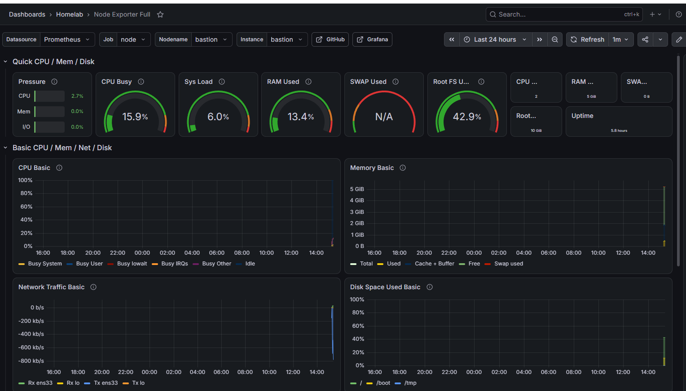
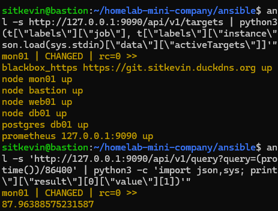
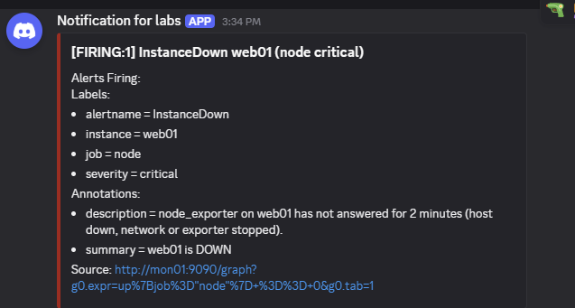
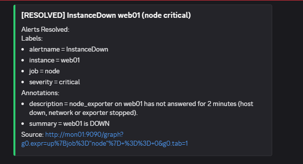
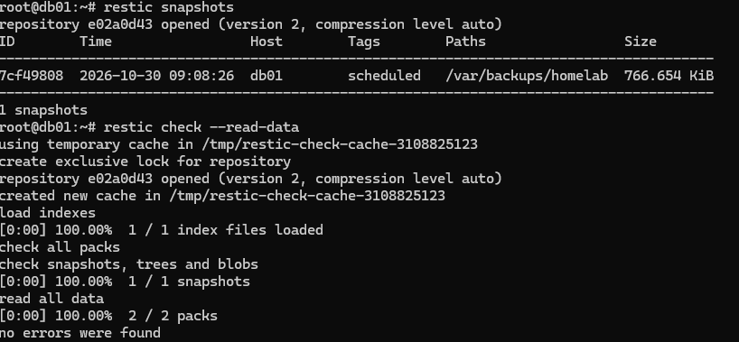
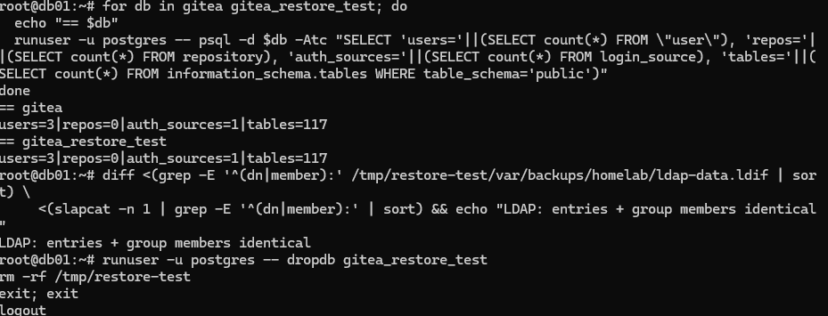
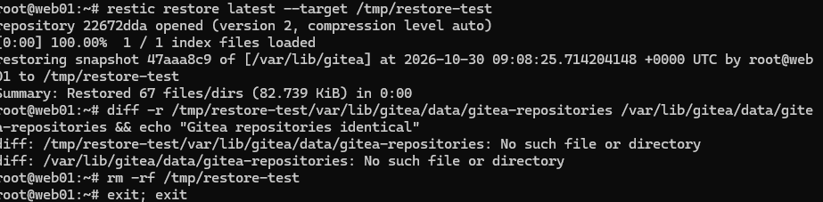

# Phase 4 — Monitoring & Backup

> Status: ✅ **complete** — Prometheus + Grafana on mon01, 9 alert rules delivered to Discord, nightly restic backups of Gitea, PostgreSQL and LDAP to mon01, and a verified restore. Everything is deployed by Ansible (`playbooks/monitoring.yml`, `playbooks/backup.yml`, both part of `site.yml`).

## Monitoring

```
 every host                    mon01 (localhost only, SSH tunnel)                 phone
 node_exporter :9100 ─┐
 db01 postgres_exporter ─┼─ scrape ─> Prometheus :9090 ── alerts ──> Alertmanager :9093 ──> Discord
 blackbox (HTTPS probe) ─┘              │
                                        └──> Grafana :3000 (dashboards)
```

- **Pull model:** Prometheus scrapes every target every 15 s; targets are generated from the Ansible inventory (a new host in `hosts.ini` is monitored automatically).
- **Nothing new is exposed:** Prometheus, Alertmanager, Grafana and blackbox listen on `127.0.0.1` of mon01 only. Exporters on the other hosts accept connections **from mon01 only** (ufw rule owned by each exporter role).
- **Access:** `ssh -L 3000:127.0.0.1:3000 mon01` from the Windows host, then `http://localhost:3000`.
- **Grafana as code:** datasource and the *Node Exporter Full* dashboard (grafana.com 1860, pinned revision 45) are provisioned from files — nothing is clicked by hand.
- **PostgreSQL exporter without a password:** it runs as the Linux user `prometheus` and connects through the Unix socket with `peer` authentication to a DB role that only has `pg_monitor`.
- **Validation before every change:** `promtool check config`, `promtool check rules`, `amtool check-config`, `blackbox --config.check`.




### Alert rules

| Alert | Condition | Severity |
|---|---|---|
| `InstanceDown` | node_exporter not answering for 2 min | critical |
| `PostgresDown` | `pg_up == 0` for 2 min | critical |
| `EndpointDown` | HTTPS probe of Gitea failing for 2 min | critical |
| `DiskAlmostFull` | filesystem > 85 % for 5 min | warning |
| `MemoryLow` | < 10 % memory available for 5 min | warning |
| `SystemdUnitFailed` | any unit in `failed` state for 1 min | warning |
| `CertificateExpiringSoon` | Let's Encrypt cert < 14 days (acme.sh should renew at ~30) | warning |
| `BackupFailed` | last backup exit code ≠ 0 | warning |
| `BackupTooOld` | no successful backup for 26 h | warning |

- `for:` durations avoid alerts on short blips (alert fatigue).
- Alertmanager groups alerts per `alertname` + `instance`, waits 30 s to bundle them, repeats every 4 h, and sends **resolved** notifications.
- **Inhibition:** when a host is down, its `warning` alerts are suppressed — only the root cause is reported.
- The Discord webhook URL lives in its own file (`webhook_url_file`), written with `no_log` + `diff: false`, so it never appears in `alertmanager.yml` or in Ansible output.

**Tested:** node_exporter on web01 stopped → Discord **FIRING** after ~2.5 min → started again → **RESOLVED**.




---

## Backup

**Principle: configuration is in Git (Ansible), backups hold the data Ansible can't recreate.**

| Host | Data | How |
|---|---|---|
| web01 | Gitea repositories, attachments, avatars (`/var/lib/gitea`) | restic reads the directory |
| db01 | Gitea database | `pg_dump --format=custom` (consistent dump, never the live data files) |
| db01 | PostgreSQL roles | `pg_dumpall --globals-only` |
| db01 | LDAP data + `cn=config` | `slapcat -n 1` / `slapcat -n 0` |

- **Tool:** [restic](https://restic.net) — encrypted, deduplicated snapshots. Script: [`scripts/restic-backup.sh`](../scripts/restic-backup.sh) (dumps → backup → `forget --prune` → `check`).
- **Where:** a separate host (mon01), over **SFTP**. One Unix user per client (`restic-web01`, `restic-db01`), directories `0700` — a compromised web01 can't read or delete db01's backups.
- **SSH key per client, SFTP only:** `restrict,command="internal-sftp"` in `authorized_keys` — no shell, no port forwarding. The server's host key is read from mon01 by Ansible and written to `known_hosts` (no trust-on-first-use).
- **When:** systemd timer, db01 02:00, web01 02:30 (+ up to 5 min random delay), `Persistent=true` to catch up after downtime. Logs in `journalctl -u homelab-backup`.
- **Retention:** 7 daily, 4 weekly, 6 monthly snapshots.
- **Monitored:** the script writes `homelab_backup_last_status` and `homelab_backup_last_success_timestamp_seconds` for node_exporter's textfile collector (atomic rename, previous success kept on failure) → `BackupFailed` / `BackupTooOld` alerts.

First run: web01 9 s, db01 10 s (≈ 45 MB RAM peak), `restic check`: no errors.

> Lab note: everything still runs on one physical Windows host. A 3-2-1 setup would add an off-site copy (e.g. a free cloud bucket) — listed as an extension.

---

## Restore verification

Procedure: [`docs/runbooks/restore.md`](runbooks/restore.md). Results (2026-10-30):

| Check | Result |
|---|---|
| `restic check --read-data` (every byte read and decrypted) on db01 and web01 | ✅ no errors |
| Restore latest db01 snapshot to `/tmp` | ✅ 7 files / 767 KiB in 1.7 s |
| `pg_restore` into a scratch database `gitea_restore_test` | ✅ 1.7 s |
| Live `gitea` DB vs restored DB | ✅ identical: users=3, repos=0, auth_sources=1, tables=117 |
| LDAP export vs live directory (entries + group members) | ✅ identical |
| Restore latest web01 snapshot | ✅ 67 files / 83 KiB |




