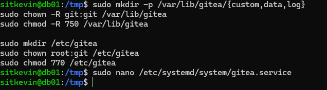

# Postmortem: Gitea installation executed on the wrong host (db01)

| | |
|---|---|
| **Date** | 2026-10-28 |
| **Severity** | Low (lab, no data loss, no downtime) |
| **Affected host** | db01 (192.168.196.12) |
| **Duration** | ~10 minutes from mistake to cleanup |
| **Author** | SitKevin |

## Summary

While following the Phase 2 runbook to install Gitea on **web01**, the commands for steps 2.1–2.4 (create `git` user, download binary, create directories, create systemd unit) were pasted into a terminal connected to **db01**. The mistake was noticed by reading the shell prompt (`sitkevin@db01:/tmp$`) before the service was started.

## Timeline

| Time (UTC+7) | Event |
|---|---|
| 14:16 | PostgreSQL setup on db01 completed; db01 terminal left open |
| ~14:20 | Gitea install commands pasted into the db01 terminal by mistake |
| 14:25 | Prompt `sitkevin@db01` noticed while creating `gitea.service` |
| 14:30 | Cleanup on db01 finished; install redone on web01 |



## Root cause

Several terminals (bastion, web01, db01) were open at the same time with identical look. Commands were copied from instructions without checking which host the terminal belonged to. Nothing in the tooling restricted which host a command could run on.

## Impact

- Unwanted `git` system user, Gitea binary, directories and a systemd unit on db01.
- Would have run an extra web service on the database server (larger attack surface, wasted RAM) if not noticed.
- No impact on PostgreSQL or data.

## Resolution

```bash
sudo systemctl disable --now gitea 2>/dev/null
sudo rm -f /etc/systemd/system/gitea.service && sudo systemctl daemon-reload
sudo rm -rf /var/lib/gitea /etc/gitea
sudo rm -f /usr/local/bin/gitea /tmp/gitea-*
sudo deluser --remove-home git && sudo delgroup git
# verify: `id git` and `ls /usr/local/bin/gitea` both fail
```

> **Update 2026-10-30:** the cleanup was incomplete. systemd still remembered `gitea.service` in the **failed** state (unit file gone, state kept in memory until reboot or reset). It was found two days later by the new health check (`node-check.sh`: `db01 WARN failed systemd units: gitea.service`) and cleared with:
> ```bash
> sudo systemctl reset-failed gitea.service
> ```
> Lesson: `disable --now` + deleting the unit file is not a full cleanup — check `systemctl --failed` afterwards.

## What went well

- The prompt shows the hostname — the error was caught before the service started.
- Every change was a known, documented step, so the cleanup list was easy to derive.

## Action items

- [x] Give each host's terminal tab a distinct name/colour (Windows Terminal).
- [x] Phase 3: all setup moved into Ansible, where the target host is explicit (`hosts: web`) — no more manual copy-paste on the wrong machine.
- [x] Health check that reports failed units on every host (`node-check.sh`, Phase 3).
- [ ] Optional: coloured prompt per role (e.g. red on db01) via `PS1` in `/etc/bash.bashrc`.
